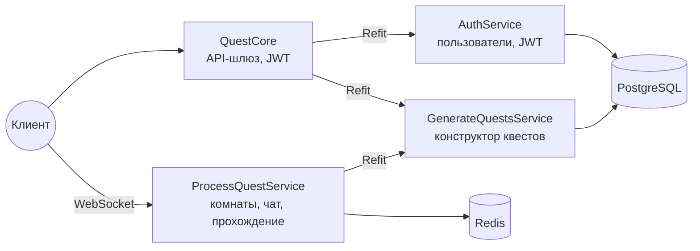

# Quests

Платформа квестов: конструктор квестов с развилками и прохождение в комнатах в реальном времени с чатом. Это вторая
версия проекта, который сейчас развивается как **Dophamint** (v3 — модульный монолит на .NET 10, код закрыт).

**Стек:** C# · ASP.NET (.NET 6/7) · Entity Framework Core · PostgreSQL · Redis · WebSocket · Refit · JWT · Docker

## Архитектура



| Сервис | Роль |
| --- | --- |
| `QuestCore` | API-шлюз: проверяет JWT и проксирует запросы к сервисам через Refit |
| `AuthService` | регистрация, вход, удаление пользователей, выдача JWT |
| `GenerateQuestsService` | создание и редактирование квестов, хранение в PostgreSQL |
| `ProcessQuestService` | комнаты, чат и прохождение квеста по WebSocket, состояние комнат в Redis |
| `CommonDataContracts`, `CommonDatabase.QuestDatabase`, `Utils/CommonInfrastructure` | общие контракты, модель БД и инфраструктура |

## Запуск

```bash
cp .env.example .env    # задайте пароль PostgreSQL, ключ JWT, секрет хэширования паролей и NUGET_GITHUB_TOKEN
docker compose up --build
```

| Сервис | Адрес |
| --- | --- |
| QuestCore | http://localhost:9003 |
| PostgreSQL | localhost:5555 |

AuthService и GenerateQuestsService наружу не публикуются: к ним обращается только QuestCore по внутренней сети
docker compose.

Секретов в репозитории нет: в `appsettings*.json` стоят заглушки `CHANGE_ME`, реальные значения docker compose
передаёт из `.env` переменными окружения (`ConnectionStrings__DefaultConnection`, `Jwt__Key`,
`Secret__PasswordHash`). Для запуска сервисов из IDE задайте те же переменные или `dotnet user-secrets`.

## Лицензия

MIT — см. [LICENSE.txt](LICENSE.txt).
